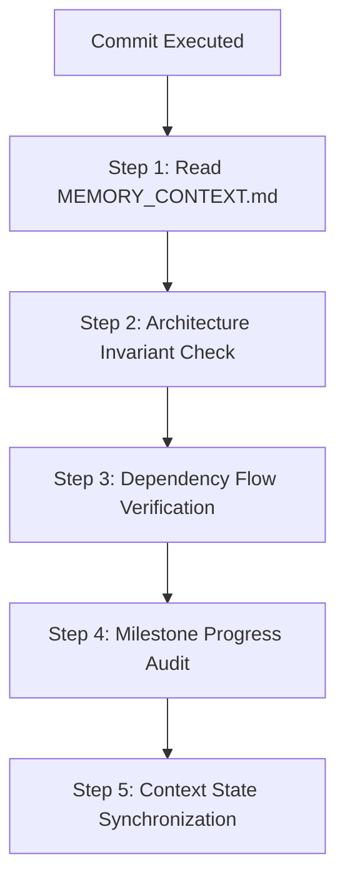

# ECHO ENGINE & ECHOES OF TOMORROW — PERSISTENT MEMORY CONTEXT

> **Operational Directive:** This document serves as the authoritative long-term memory anchor for developers and AI assistants. **Re-read and verify against this document after every single commit and before starting any new phase** to prevent context drift, avoid unauthorized refactoring, and maintain strict adherence to project milestones.

---

## 1. Executive Project Charter & System Identity

### 1.1 The Trilogy Hierarchy
```text
Echoes of Tomorrow (The Game)
        │
        ▼ (drives design & validates requirements)
    Echo Engine (The Custom Runtime)
        │
        ▼ (extracts game-agnostic core post-shipping)
   Forge Engine (The Reusable Platform)
```

1. **Echoes of Tomorrow (The Game):**
   - A narrative-driven, first-person shooter set in a post-war futuristic Indian megacity blending cyberpunk verticality, military authenticity, psychological tension, and natural greenery reclaiming civilization.
   - Protagonist: Captain Arjun Rao navigating reality vs. corrupted memory fragments.
   - Inspirations: *Metro, S.T.A.L.K.E.R., Escape from Tarkov, Battlefield, Half-Life, Dying Light*.

2. **Echo Engine (The Dedicated Engine):**
   - A modern, high-performance, **code-first, runtime-first** engine built in ES2023 / Three.js without editor dependencies.
   - Built simultaneously with the game: no speculative abstractions—subsystems exist because the game requires them.
   - Core innovation: **Hardware-Adaptive Optimization System (HAOS)** dynamically tuning workloads across hardware tiers.

3. **Forge Engine (Long-Term Extraction):**
   - The standalone, game-agnostic evolution extracted only *after* Echo Engine ships *Echoes of Tomorrow*.

---

## 2. Core Philosophy & Non-Negotiable Directives

### 2.1 The Golden Rules
> [!IMPORTANT]
> **Complete First. Refine Later.**
> *A finished engine can always be improved. An unfinished perfect architecture ships nothing.*

1. **Architecture is Frozen:**
   - Unless explicitly commanded by the lead developer, the architecture is fixed.
   - **Do NOT** redesign subsystems, rename existing modules, move classes into alternative hierarchies, or swap out architectural patterns.
   - If an implementation detail does not fit, adjust the implementation to fit the architecture—never change the architecture to fit the implementation.

2. **Strict Downward Dependency Flow (Ch. 4 §3):**
   ```text
   Game
     │
     ▼
   Scene Runtime
     │
     ▼
   World System
     │
     ▼
   Asset System
     │
     ▼
   Framework Core
   ```
   - Dependencies flow strictly **downward**.
   - Zero cyclic dependencies. Violations break the architectural contract.

3. **Rendering is a Downstream Consumer, Never an Owner (Ch. 6 & Ch. 11):**
   - The **World System** and **ECS** are the sole authoritative sources of truth for simulation state and spatial hierarchy.
   - The Three.js scene graph is purely a visualization layer. Rendering reads transform and mesh components and draws; it never mutates or owns simulation data.

4. **Service-Based Architecture & Decoupled Event Communication:**
   - Major systems register as framework services via `ServiceRegistry`.
   - Cross-subsystem communication occurs via `EventBus` (`EventBus.publish()` and `EventBus.subscribe()`). Direct subsystem-to-subsystem coupling is prohibited.

5. **Code-First & Runtime-First:**
   - Every feature must be configurable and operable entirely through code. Visual tools/dashboards are secondary consumers of the runtime.

---

## 3. Subsystem Architecture Matrix & Status Audit

| Subsystem | Folder (`src/`) | Files | Status | Subsystem Role & Core Components |
| :--- | :--- | :---: | :---: | :--- |
| **Framework Core** | `src/framework/` | 61 | ✅ **Complete** | Main loop (`requestAnimationFrame`), `GameClock`, `FrameScheduler`, `ServiceRegistry`, `EventBus`, `GameStateMachine`, `CompositionRoot`, `Bootstrap`, `RuntimeHost`, `RuntimeKernel`. |
| **Time System** | `src/time/` | 11 | ✅ **Complete** | Deterministic simulation clock (`WorldClock`), priority/time-ordered event queue (`ReadyQueue`, `SchedulerState`, `EventScheduler`), `DependencyGraph`, `SectorSchedulerState`, `TimeSerializer`. |
| **ECS Core** | `src/ecs/` | 10 | 🚧 **In Progress** | `ECSManager`, `ComponentStore<T>`, `SparseSet`, `Entity`, `EntitySignature` (128-bit mask), `EntityView`, `SystemScheduler`. |
| **ECS Components** | `src/components/` | 5 | 🚧 **In Progress** | `TransformComponent`, `VelocityComponent`, `HealthComponent`, `MeshComponent`, `AudioComponent`. |
| **ECS Systems** | `src/systems/` | 3 | 🚧 **In Progress** | `MovementSystem`, `HealthSystem`, `AnimationSystem`. |
| **World System** | `src/world/` | 9 | 🚧 **In Progress** | `World`, `WorldManager`, `Transform`, `Entity`, `EntityHandle`, `EntityID`, `RegionID`, `SectorID`, `CellID`. |
| **World Hierarchy**| `src/hierarchy/` | 3 | 🚧 **In Progress** | Spatial hierarchy: `Region` → `Sector` → `Cell`. |
| **Spatial Partition**| `src/spatial/` | 1 | 🚧 **In Progress** | `GridPartition` for uniform grid mapping. |
| **World Managers** | `src/managers/` | 5 | 🚧 **In Progress** | `WorldGraph`, `EntityManager`, `SpatialManager`, `StreamingManager`, `QueryManager`. |
| **World Registries**| `src/registries/` | 4 | 🚧 **In Progress** | `RegionRegistry`, `SectorRegistry`, `CellRegistry`, `EntityRegistry` (O(1) Map stores). |
| **Spatial Queries** | `src/queries/` | 3 | 🚧 **In Progress** | `RadiusQuery`, `CellQuery`, `NearestQuery`. |
| **Streaming** | `src/streaming/`, `src/managers/` | 4 | ✅ **Complete (Phase 12)** | `StreamingManager`, `WorldPartition`, `SectorLoader`, `SectorUnloader`, `StreamingJob`. Player proximity-driven grid partition streaming and cell residency management. |
| **Scene Runtime** | `src/scene/` | 8 | 🚧 **In Progress** | `SceneManager`, `Scene`, `CameraManager`, `Camera`, `Environment`, `SceneTransition`, `SceneState`. |
| **Asset System** | `src/assets/` | 16 | 🚧 **In Progress** | `AssetService`, `AssetManager`, `AssetRegistry`, `AssetCache`, `AssetLoader`, `AssetDescriptor`, `AssetHandle`, format loaders. |
| **Rendering** | `src/rendering/` | 2 | ✅ **Complete (Milestone A)** | `EnvironmentSetup` (PBR, lighting, fog, ACES tone mapping), `PBRTextureGenerator`. `RenderService` connects Three.js renderer as a pure downstream consumer of World and ECS entities. |
| **Physics & Collision**| `src/physics/`, `src/systems/`, `src/framework/services/` | 4 | ✅ **Complete (Phase 8)** | `PhysicsService`, `CollisionWorld`, `AABB`, `PhysicsSystem`, `ColliderComponent`, `RigidBodyComponent`. Static & dynamic collision resolution, gravity, player collision response. |
| **Animation System**| `src/animation/`, `src/components/`, `src/systems/` | 36 | ✅ **Complete (Phase 9)** | `AnimationComponent`, `AnimationClip`, `SkeletonPose`, `AnimationPlayer`, `AnimationController`, `VATPlayer`, `AnimationSystem`. Skeletal keyframe sampling, cross-fading, and VAT playback. |
| **Player & Input** | `src/player/`, `src/framework/services/` | 2 | ✅ **Complete (Milestone A)** | `PlayerController` (first-person WASD + pointer-lock mouse look + physical collision). `PlayerService` and `InputService` fully wired into frame pipeline. |
| **Diagnostics** | `src/framework/diagnostics/` | 2 | ✅ **Complete** | `DiagnosticsService`, `PerformanceCounters` (FPS, frame times, memory metrics). |
| **Audio** | `src/audio/`, `src/systems/`, `src/framework/services/` | 4 | ✅ **Complete (Phase 10)** | `AudioService`, `AudioManager`, `SoundSynthesizer`, `AudioSystem`. Procedural sound synthesis (footsteps, impacts, cyber drone, chime), 3D spatial panner attenuation, listener tracking. |
| **AI & Navigation** | `src/ai/`, `src/components/`, `src/systems/`, `src/framework/services/` | 6 | ✅ **Complete (Phase 11)** | `AIService`, `AISystem`, `BehaviorTree`, `Blackboard`, `AIComponent`, `NavigationComponent`. Vision perception, chase/patrol states, waypoint traversal. |
| **Gameplay Framework** | `src/gameplay/`, `src/components/`, `src/systems/`, `src/framework/services/` | 4 | ✅ **Complete (Phase 13)** | `GameplayService`, `MissionManager`, `InteractionSystem`, `InteractableComponent`. Story missions, objective tracking, proximity interaction triggers, Memory Fragment retrieval. |
| **UI Framework** | `src/ui/`, `src/framework/services/` | 2 | ✅ **Complete (Phase 14)** | `UIManager`, `UIService`. In-game HUD (integrity/stamina bars), dynamic interaction prompts, mission checklist, notification banners, pause menu overlay. |

---

## 4. Phased Roadmap & Milestone Targets

```text
Phase 0: Tooling & Engineering Standards ─── [Completed]
Phase 1: Framework Core & Diagnostics ────── [Completed]
Phase 2: ECS Core ────────────────────────── [Completed for Milestone A]
Phase 3: World System & Spatial Pipeline ─── [Completed for Milestone A]
Phase 4: Scene Runtime (D013) ────────────── [Completed for Milestone A]
Phase 5: Asset System & Loaders ──────────── [Completed for Milestone A]
Phase 6: Minimal Rendering (Consumer) ────── [Completed for Milestone A]
Phase 7: Input & Player Service ──────────── [Completed for Milestone A]
   ▲
   └── [MILESTONE A: "Grey-box Playable" — ACHIEVED]
Phase 8: Physics & Collision ─────────────── [Completed]
Phase 9: Animation & VAT Runtime ─────────── [Completed]
Phase 10: Audio System ───────────────────── [Completed]
Phase 11: AI & Navigation ────────────────── [Completed]
Phase 12: Streaming & World Partition ────── [Completed]
Phase 13: Gameplay Scripting Framework ───── [Completed]
Phase 14: UI / UX Framework ──────────────── [Completed]
Phase 15: Persistence & Save System ──────── [Current Target]
   ▲
   └── [CURRENT TARGET: MILESTONE B — "Vertical Slice"]
Phase 16: HAOS (Hardware-Adaptive Optimization)
Phase 17: Editor & Developer Toolchain
   ▲
   └── [TARGET: MILESTONE C — "Content-Ready Pipeline"]
Phase 18: Full Content Production (Echoes of Tomorrow)
Phase 19: Networking & Multiplayer (Optional)
Phase 20: Security, Packaging & Deployment
   ▲
   └── [TARGET: MILESTONE D — "Shippable"]
Phase 21: Forge Engine Extraction
```

### Active Milestone: Milestone B ("Vertical Slice")
**Milestone A Status:** ✅ **Delivered & Verified**
- `InputService` capturing keyboard, mouse look, and pointer-lock with action bindings.
- `PlayerService` coordinating `PlayerController`, camera orientation, and ECS entity synchronization.
- `RenderService` acting as downstream consumer rendering ECS entities and grey-box PBR arena.
- `index.html` configured with ES module import maps and real-time HUD telemetry.
- Automated dependency validation script (`test/validate_codebase.py`) passing with 0 broken imports and 0 conflict markers.

**Immediate Next Goals for Milestone B:**
1. **Phase 8 (Physics & Collision):** Basic bounding boxes / collision detection for player against arena walls and props.
2. **Phase 9 (Animation System):** Connecting skeletal playback and VAT runtime to ECS entities.
3. **Phase 10 (Audio System):** WebAudio spatial audio service for footstep and ambient sound effects.

---

## 5. Post-Commit Recalibration Protocol

> [!CAUTION]
> **MANDATORY POST-COMMIT CHECKLIST**
> Execute this 5-step checklist after **every single commit**:



1. **Step 1: Read Memory Context Anchor**
   - Review this file to re-ground goals, active milestone, and constraints.
2. **Step 2: Architecture Invariant Check**
   - Did the commit respect the Architecture Freeze?
   - Did it avoid speculative redesigns or premature refactors?
   - Are public API contracts preserved?
3. **Step 3: Dependency Flow Verification**
   - Confirm dependencies only flow downward: `Game → Scene → World → Assets → Framework`.
   - Ensure `rendering/` or `services/RenderService.js` did not acquire state ownership.
   - Verify zero circular module imports.
4. **Step 4: Milestone Progress Audit**
   - Identify which Milestone A or B component was advanced.
   - Update the status table in this document if a subsystem transition occurred.
5. **Step 5: Context State Synchronization**
   - Keep next task laser-focused on the next unblocked phase item.

---

## 6. Coding Standards & Architectural Guardrails

1. **Language & Modules:**
   - ES2023 JavaScript Modules (`import` / `export`), `"type": "module"` in `package.json`.
   - Strict avoidance of global scripts, window pollution, or undeclared globals.

2. **JSDoc on All Public APIs:**
   - Every public class, method, property, and parameter must include accurate JSDoc typing.

3. **Performance on Hot Paths:**
   - Hot update paths (`FrameScheduler.run`, `System.update`, `SpatialManager`, `WorldClock.tick`) must allocate **zero new objects per frame**.
   - Reuse scratch vectors/matrices, pool events where feasible, use `SparseSet` for $O(1)$ ECS iterations.

4. **Naming Conventions:**
   - Classes / Types: `PascalCase` (e.g., `PlayerController`, `ComponentStore`).
   - Methods / Functions / Variables: `camelCase` (e.g., `registerService`, `deltaTime`).
   - Private Members: Leading underscore `_privateField`.
   - Constants / Enums: `UPPER_SNAKE_CASE` (e.g., `SCHEDULED_FIRE`, `AUTH_TOKEN`).

5. **Entity-Component Separation:**
   - Entities: Numeric ID + generation counter (`EntityID`), 128-bit bitmask (`EntitySignature`). No logic, no properties.
   - Components: Pure plain data containers. No behavior.
   - Systems: Pure behavior. Read components, write components, trigger events.

---

## 7. Authoritative References & Source Documentation

- **Master Specification:** [`docs/# Echo Engine Design Document (EDD).txt`](file:///c:/Users/hp/Documents/codes/ACTIVE-GPT--EchoesOfTomorrow-/docs/%23%20Echo%20Engine%20Design%20Document%20(EDD).txt) (16,000+ lines, 25 chapters)
- **Development Policy:** [`11-AUG-2026 repomix_Echo Engine Development Policy.txt`](file:///c:/Users/hp/Documents/codes/ACTIVE-GPT--EchoesOfTomorrow-/11-AUG-2026%20repomix_Echo%20Engine%20Development%20Policy.txt)
- **Build-Order Roadmap:** [`Echo_Engine_Implementation_Roadmap.md`](file:///c:/Users/hp/Documents/codes/ACTIVE-GPT--EchoesOfTomorrow-/Echo_Engine_Implementation_Roadmap.md)
- **System Vision:** [`# Echo Engine.txt`](file:///c:/Users/hp/Documents/codes/ACTIVE-GPT--EchoesOfTomorrow-/%23%20Echo%20Engine.txt)
- **Architecture Snapshot & Health:** [`ProjectSummary.md`](file:///c:/Users/hp/Documents/codes/ACTIVE-GPT--EchoesOfTomorrow-/ProjectSummary.md)
